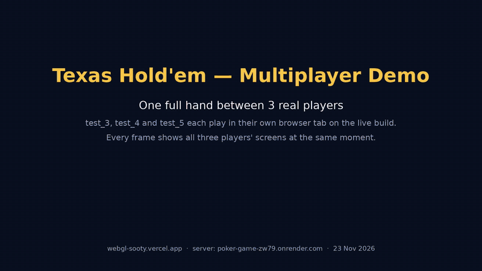

# Multiplayer Texas Hold'em

[](https://github.com/Nil-fantosia/Poker-Game/actions/workflows/server.yml)

A multiplayer Texas Hold'em prototype for 2 to 6 players, played with **virtual chips
only**. There are no real money deposits, withdrawals or wagers, no purchases and no
loot boxes. Players join a table from different devices, and **all game logic runs on
the server**.

| Part | Technology |
|---|---|
| Client | Unity 2022.2.2f1 (WebGL, Windows, Android), TextMeshPro, DOTween |
| Networking | **Socket.IO v4**: Node server + the Firesplash Entertainment Socket.IO client in Unity (`Assets/Firesplash Entertainment`). Login over HTTP/JSON. |
| Server | Node.js 18+, Express, Socket.IO |
| Player data | **MongoDB** (official `mongodb` driver) when `MONGODB_URI` is set; JSON files otherwise |

**Target layout:** desktop, landscape (designed at 1920x1080 and scaling to any
landscape window, in the browser via WebGL or as a Windows build). It also runs on
Android phones and tablets in landscape, but the layout is tuned for desktop.

**Play it now (WebGL):** https://webgl-sooty.vercel.app (the game; it talks to the Socket.IO
server at https://poker-game-zw79.onrender.com). The server runs on a free host, so the
first request after a quiet period can take up to a minute while it wakes up. To test
multiplayer, open the link in two or three browser windows (use a different account in
each, and leave *Remember me* unticked), create a table in one and join it by code from
the others; see section 2. A requirement-by-requirement check against the task sheet is in
[qa/reports/task-compliance.md](qa/reports/task-compliance.md).

**Video:** a full 3-player hand, from the lobby to the showdown.

[](media/poker_3player_hand_demo.mp4)

The preview above plays in the page (full 2:22 hand, low quality). Click it for the full-quality video: [media/poker_3player_hand_demo.mp4](media/poker_3player_hand_demo.mp4).

See [CODE_GUIDE.md](CODE_GUIDE.md) for a walk-through of every class.

---

## Contents
1. [How to run](#1-how-to-run)
2. [How to test multiplayer with two or more players](#2-how-to-test-multiplayer-with-two-or-more-players)
3. [Main design decisions](#3-main-design-decisions)
4. [Requirements checklist](#4-requirements-checklist)
5. [Known issues and limits](#5-known-issues-and-limits)
6. [Scope: done and left out](#6-scope-done-and-left-out)
7. [Repository layout](#7-repository-layout)
8. QA: test strategy, reports, manual test plan, bug log: [`qa/README.md`](qa/README.md)

---

## 1. How to run

### Server
```
cd poker-server
npm install
cp .env.example .env      # optional: blinds, turn time, ports, MongoDB
npm start
```
The server listens on `http://localhost:3000`; `GET /health` returns `{"status":"ok"}`.

**Player data (accounts, profiles, settings, login tokens, stats):**
- **MongoDB:** set `MONGODB_URI` (and optionally `MONGODB_DB`, default `poker`) in `.env`,
  e.g. a free MongoDB Atlas cluster. Collections `users`, `tokens` and `stats` and their
  indexes are created on start; expired login tokens are deleted by MongoDB (TTL index).
- **No database:** leave `MONGODB_URI` empty and the same data is saved as JSON files in
  `DATA_DIR` (default `./data`). Handy for running the project with nothing installed.

The start-up log says which one is used (`Player data: MongoDB ...` or `JSON files ...`).

### Client (Unity Editor)
1. Open `poker-unity/PokerGame` with **Unity 2022.2.2f1**.
2. Run **Tools > Poker > Build Scenes** (needed the first time, and again after
   pulling changes to the UI). This imports TextMeshPro's essentials if needed, then
   generates the UI images and the placeholder sounds, creates the Splash, Lobby and
   Game scenes, and adds them to Build Settings.
3. The server address is set in `Assets/Resources/ServerConfig` (default `http://localhost:3000`).
4. Open `Assets/Scene/Splash` and press **Play**. Create an account and sign in.

### WebGL build and hosting
**One click:** **Poker > Build WebGL** builds into `Build/webgl` (not committed) with
compression switched off, so it loads on any static host (Vercel, GitHub Pages,
`python -m http.server`) without special headers. The server address baked into the build
comes from `Assets/Resources/ServerConfig` (currently the hosted Render server).

**How the submitted demo is hosted:** the WebGL build is a static site on Vercel, and
the Node server runs on Render (a long-running process, which Socket.IO needs). On Render
set `CORS_ORIGIN` to the exact Vercel address so browsers may connect. Both links are at
the top of this README.

**Alternative, one address for both:** the server can host the build itself, which also
avoids browsers blocking an https page from talking to an http server.
1. In `Assets/Resources/ServerConfig`, **clear `Server Url`**. An empty value makes a
   WebGL build talk to the address it was loaded from.
2. **File > Build Settings > WebGL > Build**, output to `poker-server/public/`.
   Compression can be left on (Brotli or Gzip); the server sends the right headers.
3. `npm start` and open `http://localhost:3000/`.
4. To put it online, deploy `poker-server/` (including `public/`) to any Node host,
   for example a Render or Railway "Web Service" with start command `npm start`. The
   host provides https, and invite links and the server address follow automatically.
   Set `MONGODB_URI` on the host: many free hosts reset files on redeploy, which
   would clear accounts, profiles and stats saved as JSON files.

### Automated tests
```
cd poker-server
npm test               # 126 tests: hand ranking, side pots, pot distribution, betting rules, bots, stats, a full
                       # 6-player table over real sockets (hidden cards, button, showdown, chip totals),
                       # waiting list, hand history, chat, reactions, storage, accounts, profile and settings rules
npm run test:mongo     # the storage/account/profile/stats tests again on a real MongoDB
                       # (mongodb-memory-server downloads one the first time; nothing to install)
npm run test:e2e       # starts a throwaway server and plays through the network: login, join by code,
                       # reconnect, waiting room, host start, bots tables (join mid-hand, take a bot's seat),
                       # stats, hand history, chat, profile + settings, seat freed after disconnect
npm run test:e2e:mongo # the same end-to-end run with the server on MongoDB
npm run play:bots   # watch real hands against bots in the console (against a running server)
```

Every push and pull request runs all of these on GitHub Actions (`.github/workflows/server.yml`):
lint, unit tests, MongoDB storage tests and both end-to-end runs. `npm run lint` checks the
server with ESLint and Prettier.

### Load test

All QA material (load test, test runner, manual test plan, bug log, reports) is in
**[`qa/`](qa/README.md)**. `cd qa && npm install && npm run load-test` starts a throwaway
server, connects one player per bots table, plays fast hands for a while and reports
what the server saw through `GET /metrics` (tables, players, hands per minute,
event-loop delay, memory). Add `-- --tables=200 --seconds=60 --report` to save a report.
`npm run test:all` (also in `qa/`) runs every automated check and saves a report.

Result on a laptop (Windows, Node 24, JSON storage), 200 tables x 6 seats = 200 players +
1,000 bots, bots acting every ~0.2 s (about 10x faster than real play):

| | Before the fix | After |
|---|---|---|
| Hands per minute | 1,466 | **2,508** |
| Your action answered (p50 / p95 / p99) | 33 / 346 / 545 ms | **6 / 19 / 34 ms** |
| Worst event-loop delay (p99) | 695 ms | **64 ms** |
| Errors / rejected actions | 0 / 0 | 0 / 0 |

What the load test found, and what was fixed:
- **JSON storage blocked the server.** Every save rewrote the whole file synchronously
  (several MB of hand histories, ~24 times a second). Saves are now batched: at most one
  background write per second per file (temp file + rename), and pending changes are
  written on shutdown.
- **Lost updates** (found by the end-to-end run on MongoDB right after): stats and hand
  history read a player's document, change it and write it back; two hands of one player
  finishing together could overwrite each other. Saves now run one at a time per player
  (`utils/KeyedQueue.js`); a test with a deliberately slow database proves it.

---

## 2. How to test multiplayer with two or more players

You need **one account per player**. Untick *Remember me* when running several clients
on one machine: browser tabs (and builds of the same app) share saved settings, so a
remembered login would sign every client in as the same player.

**On one computer.** Start the server. Then open the game several times: in the Unity
Editor plus a Windows build, or in several browser tabs/windows if you use the WebGL
build hosted at `http://localhost:3000/`.

**On different devices.** Run the server on a machine the others can reach (same
Wi-Fi, or the hosted build above) and point `Server Url` at it, e.g.
`http://192.168.1.20:3000`.

**A 3-player hand, step by step**
1. Player A: **Lobby > Play with friends > 3 players > Create**. A waiting room
   shows a 5-letter room code and an invite link.
2. Players B and C: type the code in **Join with a code**, pick the table from
   **Open tables**, or open the invite link (WebGL). Each one sits down; everyone
   sees the seats fill up.
3. When the third player sits, the game starts for everyone at the same moment. The
   host can also press **Start now** with 2 or more players.
4. Play: the glowing seat with the timer ring is the player to act. Only legal
   buttons are enabled. **Hand rankings** (bottom-left) shows the hand chart and marks
   your current hand.

**Things worth trying**
- **Timer:** don't act for 30 seconds. You check if checking is free, otherwise you fold.
- **Disconnect:** close a client mid-hand. The seat shows OFFLINE, turns time out, and
  reopening the game within 2 minutes puts you back in the same seat with the same chips.
- **Join mid-hand:** a new player watches ("Dealt in next hand") and joins the next hand.
- **Leave mid-hand:** the player is folded and their chips already bet stay in the pot.
- **Side pots:** have two players go all-in for different amounts (e.g. after one has lost chips).
- **Out of chips:** go all-in and lose. You become a spectator with a free "Restart with 1,000".
- **Cheating:** the server rejects anything out of turn or against the rules (see
  `npm test` "actions out of turn or against the rules are rejected").
- **Server down:** stop the server. Clients show "Connection lost. Reconnecting...".

Playing alone: **Play vs bots** fills the table with bots (easy, normal, hard).

Joining a bots game: a friend can enter the code of your *Play vs bots* table. If a
hand is running they watch it (no cards, no turns). When it ends, the bot with the
fewest chips stands up and the friend takes its seat for the next hand.

---

## 3. Main design decisions

**Server-authoritative.** Shuffling (crypto-secure random), dealing, validating every
action and deciding winners happen only on the server. Clients send intentions
(`fold`, `raise to 120`) and receive state; they never send results.

**Hidden information never leaves the server.** Every state message is built per
player in `game/playerView.js`, the single place where state becomes a client
payload. You get your own hole cards; others' cards are added only when shown at
showdown. Bots receive exactly the same filtered view as a human in their seat.

**Snapshots, not diffs.** After every change each player receives a full snapshot of
the table as they may see it. The client stays simple and stateless, reconnecting is
just "receive the latest snapshot", and animations and sounds are derived on the
client by comparing two snapshots, so no extra events are needed.

**Pure rules engine.** `src/engine` (cards, hand evaluator, pots, hand, table) has no
sockets, timers or I/O, so the rules are unit-tested directly. `TableRunner` decides
*when* things happen (timers, bots, next hand); the engine decides *what* is allowed.

**Identity from a login token.** Accounts use scrypt-hashed passwords. Login returns a
random token, and the server stores only its SHA-256. The token is checked in the
Socket.IO handshake, so a player's identity never comes from client data. The same
token lets a dropped player reconnect to their seat. *Remember me* stores only the
token (30 days); logging out revokes it.

**Player data behind one small interface.** `src/storage` gives every service the same
async collections (`get`, `findOne`, `set`, `update`, `delete`) backed by MongoDB or JSON
files. Accounts, profiles, settings and stats are written once, and the same tests run
against both backends. Profile and settings rules (`services/profileRules.js`) are pure
functions: display name 3-16 characters, avatar 0-11, bio up to 80 characters, settings
whitelisted and typed. Unknown fields are never stored.

**Profile and settings follow the account.** The client keeps settings on the device
(works offline and before login) and `ProfileManager` saves player changes to the
account a moment later. On login the account's settings replace the device's, except the
first time, when the device's choices are uploaded. A profile edit shows at once on the
player's seat and in chat (`sockets/profileSync.js`).

**Tables: two modes.** *Play with friends* tables wait in a waiting room until every
seat is filled (or the host starts), so everyone starts together. *Play vs bots*
tables fill empty seats with bots. Bots are kept out of friends tables on purpose,
so friends play each other. A bots table is not in the public list, but a friend
with the code can join: they wait for the hand in progress to end (no one is
dealt in or removed mid-hand), then replace the bot with the fewest chips.

**Chips belong to a table.** Every player sits down with 1,000 chips. Busting out
makes you a spectator with a free restart; nothing is ever sold.

**Client code structure.** `GameController` only coordinates. Each part of the screen
has its own class (seats, board, panels, result, your hand, animations, sounds). All
static values (texts, colours, timings, layouts, the hand chart) live in
`Constants.cs`; all data shapes live in `DataModel.cs`. The UI is generated by an
editor tool, so the scenes are reproducible from code.

**Responsible design.**
- One retention feature only: **Your stats** in the lobby (hands played, hands won,
  biggest pot, best hand). They are facts, not goals: no streaks, daily rewards,
  countdowns or timers pushing you to play.
- After **1 hour** of play a gentle *"Time for a break?"* message appears (then again
  every hour). *Don't remind me* turns it off; it can be switched back on in the lobby
  (**Break reminders: On/Off**).
- Restarting after losing all chips is free and unlimited; there is no shop.
- Sound and music can be switched off separately.

---

## 4. Requirements checklist

| Requirement | Where / how |
|---|---|
| Create a table, join by code or from a list | Lobby: create (mode + 2-6 seats), 5-letter code, open-tables list, invite links |
| Server-authoritative shuffle, deal, winner | `engine/cards.js` (crypto shuffle), `HoldemHand.js`, `handEvaluator.js`, `pots.js` |
| Nobody sees opponents' cards | `game/playerView.js`; tested ("public snapshot never contains hole cards", bots peek test) |
| Real-time sync, secrets hidden per player | Per-player `tableState` after every change (`broadcast.js`) |
| Turn timer, auto fold (or check) | `TurnTimer.js` + `HoldemHand.actOnTimeout`; 30 s, ring on the active seat, ticking in the last 5 s |
| Join / leave mid-hand | Joiners watch until the next hand; leavers are folded, bets stay in the pot (tested) |
| Blinds, dealer button moving | `HoldemHand.start`, `Table.startHand` (tested, incl. heads-up) |
| Pre-flop, flop, turn, river, showdown | `HoldemHand.endBettingRound` (tested) |
| Fold / Check / Call / Raise / All-in, illegal ones disabled | `getLegalActions` (server) → `ActionBar` disables what isn't allowed |
| Hand ranking Royal Flush to High Card, ties | `handEvaluator.js` (tested: every rank, kickers, wheel, board plays) |
| Side pots (mandatory) | `pots.js` (tested: 3 all-ins, folded chips, side pot to next best) |
| Show winning hands | Result screen with the winning 5 cards; winning cards highlighted on the table; opponents' cards revealed at showdown; split pots and side pots list every winner |
| Clear UI: cards, board, pot, chips, turn, last action | Seats show chips, last action badge, dealer button, turn glow and timer |
| New players understand without a manual | Only legal buttons enabled, *Hand rankings* chart with rules, "your hand" label under your chips, street banners |
| Min bet = big blind; min raise ≥ previous raise | `HoldemHand.getLegalActions/raiseTo` (tested) |
| Half pot / pot buttons + custom amount | `ActionBar` (slider and typed amount, clamped to the legal range) |
| Short stack call → automatic all-in | `HoldemHand.applyAction` (tested) |
| Bots, levels with different behaviour | `BotPlayer.js`: easy (calls a lot), normal (by strength), hard (tight, bigger raises, bluffs) |
| Split pot, odd chip closest to the button | `pots.distributePots` (tested) |
| Out of chips → spectator + free restart 1,000 | `Table.rebuy`, "Out of chips" screen, no purchase anywhere |
| Disconnect mid-hand: auto fold after timeout, reconnect keeps state | Seat marked OFFLINE, turns time out; same seat and chips on return; seat freed after 2 min (`reconnectGrace.js`, e2e tested) |
| Server disconnection: clear message | "Connection lost. Reconnecting..." banner; after a server restart the client explains the table was closed (see Known issues for what happens to bets) |
| Cheating attempts rejected | Turn, action, amount and chips validated in the engine; payload validation in handlers (tested) |
| One retention feature | Player statistics (`StatsService.js`, lobby *Your stats*) |
| Long-session notification with off switch | *Time for a break?* after 1 h (`SessionClock`, `BreakReminderPanel`), toggle in lobby |
| Optional: sound and dealing animations | Dealing, chips, street banners; music and sound effects (placeholders made in code) with on/off |
| Extra: profile and settings in MongoDB | Lobby profile card and editor (avatar, display name, bio); Settings panel in Lobby and Game (music/sound on/off + volume, hand-strength hint, four-colour deck, chat on/off, break reminders); saved per account (`/profile` routes, tested on MongoDB) |
| Extra: table chat (separate module) | `poker-server/src/chat/` + `Assets/Scripts/Chat/`: table-only messages, quick phrases, unread badge, hand log ("Ava won 300 with Flush"), history for late joiners, 140-char limit, rate limit, swear-word masking, names from the login (tested) |
| Extra: hand history | Your last 30 hands, saved per player (MongoDB or JSON): list with your cards and chips won/lost; each hand street by street (board, every action, time-outs, showdown cards, winners). Others' cards only if shown at showdown. Open from the Lobby stats card or "History" at the table (`services/handRecord.js`, `HandHistoryService.js`, tested) |
| Extra: emote reactions (stand-alone module) | `poker-server/src/reactions/` + `Assets/Scripts/Reactions/`: 12 emotes; send to everyone (pops over your seat) or throw at one player (flies across the table); open from the Emotes button, the chat window, or by clicking a player; table members only, rate limited (tested, including on a bare Socket.IO server) |
| Optional: tests for ranking and pots | `test/handEvaluator.test.js`, `test/pots.test.js` (+ hand, table, bots, stats, e2e) |

---

## 5. Known issues and limits

- **Server restart / crash: the hand in progress is lost.** Tables and hands live in
  the server's memory. If the server stops, every table closes and the chips bet in
  the current hand are not returned. Accounts, profiles, settings and statistics
  are saved (MongoDB or JSON files) and survive. While the server is unreachable clients show *"Connection lost.
  Reconnecting..."*. When it comes back they reconnect automatically, are told *"The
  server restarted, so your table was closed. The hand in progress was not saved."*,
  and return to the lobby, where a new table starts everyone at 1,000 chips again. A
  production version would keep table state in a database or Redis and refund
  unfinished hands.
- **Chips carry between tables, but only in server memory.** Leave with 710 and you
  sit down with 710. Out of chips (0) gives a fresh 1,000, as "Restart" does. A server
  restart gives everyone 1,000 again.
- **One live session per account.** Opening the game in a second tab signs the first
  tab out with the message "You signed in from another tab or device"; the seat is kept.
- **Tested on desktop Chrome only;** mobile layout and other browsers are not verified.
- **Disconnected players slow the table for up to 2 minutes:** each of their turns
  waits out the 30 s timer before auto check/fold. After 2 minutes the seat is freed.
- **A friends table never adds bots.** If everyone else leaves after the game
  started, the last player waits for someone to join.
- **Single server process.** No horizontal scaling; fine for a prototype.
- **Dead-button rule simplified:** the button always moves to the next player who
  can play.
- **Invite links** open the game directly in WebGL. Windows and Android builds share
  the code (or the WebGL link if `Invite Base Url` is set); opening the installed
  Android app from a link would need a deep-link intent filter, which is not configured.
- **Layout** is designed for desktop landscape. It works on landscape phones but text
  is small on small screens; portrait is not supported.
- **Cosmetic:** while cards are being dealt, a flying card can briefly cover a name plate.
  In WebGL, text typed within about a second of clicking a field can land in the previously
  focused field (the field now takes focus explicitly; not proven fixed in every browser).
- **The long-session reminder** appears after 60 minutes (`Wellbeing.FirstReminderMinutes`);
  lower that value to see it quickly. The off switch was checked, the 60 minute wait was not.
- **Placeholder audio.** Sounds and music are synthesized by an editor tool and can be
  replaced in `Resources/SoundLibrary`. Browsers start audio only after the first click.
- **Chat history is in memory** and goes when the table closes; it is not moderated
  beyond a short swear-word list and a rate limit (5 messages per 10 s).
- **The Unity client has no automated tests.** The rules, pots, bots, stats and
  networking are tested on the server; the client is tested by hand (section 2).
- **Break reminder** counts time since the game was opened on that device.
- **Free hosting** may sleep when idle (slow first load). Without `MONGODB_URI` it may
  also reset saved accounts and stats on redeploy.
- **Display names are not unique** (login names are). Two players may both call
  themselves "Ace"; avatars and the login name in the profile tell them apart.

---

## 6. Scope: done and left out

**Done:** everything in the brief's *What to build* sections 1-7 (see the checklist
above), plus the optional sound effects, dealing and chip animations, and automated
tests for hand ranking and pot distribution. Extras: invite links and share sheet,
waiting room, hand rankings hint, a WebGL build hosted by the server, joining a
bots game by code (take a bot's seat after the hand), table chat, emote reactions, player profiles
(avatar, display name, bio), a settings panel, and MongoDB storage.

**Chat is a separate module.** `poker-server/src/chat/` never imports game code: the
game publishes neutral events (`game/gameEvents.js`: player joined, hand
finished...), and `src/index.js` passes chat the three things it needs (which table a
player is at, the table's socket room, and those events). A unit test fails if any
chat file imports game code. In Unity, `Assets/Scripts/Chat/` (namespace
`Poker.Chat`) has its own event names, models and client, and reaches the socket only
through `NetworkManager.Listen/Send`. Removing chat means deleting those folders and
two lines.

**Reactions are a stand-alone module too, and reusable outside this game.**
`poker-server/src/reactions/` imports nothing outside its folder; it is given
`groupOf`, `roomOf` and `isInGroup`, so any app with "groups" (tables, rooms, lobbies)
can use it. In Unity, `Assets/Scripts/Reactions/` uses no game or network code: the
host implements `IReactionTransport` (its socket) and `IReactionScene` (where people
are on screen). The poker table's glue is two small classes in `UI/Game/Reactions/`.

**Left out:**
- Private messages, muting or reporting a player in chat (table chat only).
- Uploaded profile pictures (12 built-in avatars instead: nothing to moderate or host).
- Leaderboards and other competitive retention features: the brief asks for one
  responsible retention feature (stats), so the profile only shows facts.
- Persistent tables and refunds after a server crash (see Known issues).

---

## 7. Repository layout

```
poker-server/              Node game server (server-authoritative)
  src/engine/              Pure poker rules: cards, hand evaluation, pots, hand/table state
  src/game/                Running tables over time: turns, bots, seating, reconnect grace,
                           per-player views, game event bus
  src/sockets/             Socket.IO handshake, event handlers, sending state
  src/http/                Login and profile routes, WebGL hosting
  src/services/            Tables, accounts + login tokens, profiles + settings, stats, hand history
  src/storage/             MongoDB or JSON-file collections behind one interface
  src/chat/                Table chat (stand-alone module)
  src/reactions/           Emote reactions (stand-alone module)
  src/bots/                Computer opponents (3 levels)
  test/                    Unit tests (node:test)
  scripts/                 End-to-end test, bot game viewer
qa/                        QA: load test, test runner, manual test plan, bug log, reports
poker-unity/PokerGame/     Unity client
  Assets/Scene/            Splash -> Lobby -> Game (generated by Tools > Poker > Build Scenes)
  Assets/Scripts/
    Core/                  Constants (all static data), server config, app services
    Network/               DataModel (all data shapes), HTTP client
    Managers/              Login, real-time connection, profile, settings, audio, session clock
    Chat/                  Table chat (separate module)
    Audio/                 Sound library asset
    Platform/              Invite links, clipboard / share sheet
    Gameplay/              Client-side hand evaluator (display only)
    UI/                    One folder per scene + Common; Game/ has Table, Panels,
                           Presenters, Animation, Audio, Preview
    Editor/                Scene, UI art and placeholder sound generators
```
